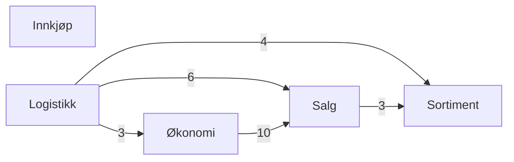
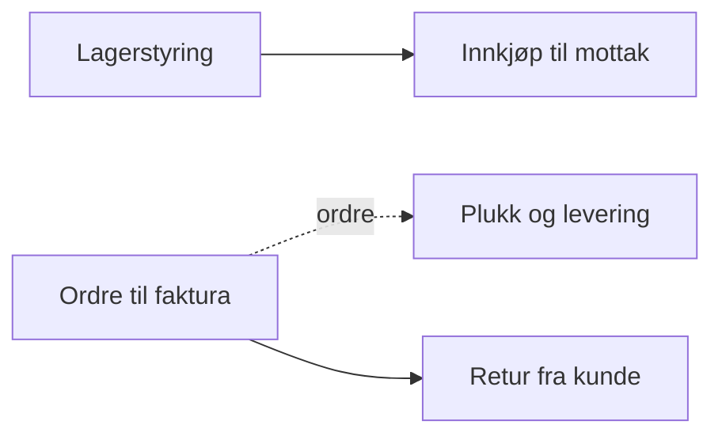
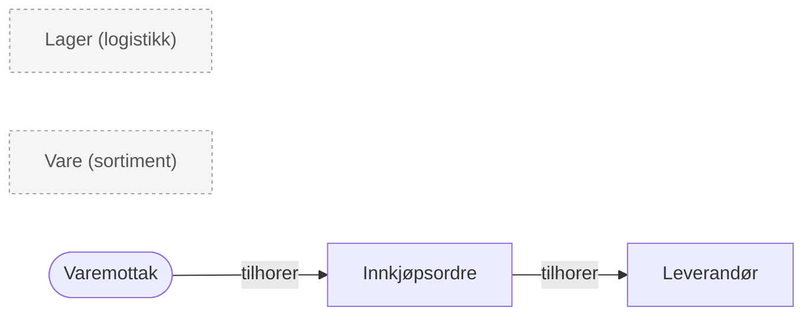
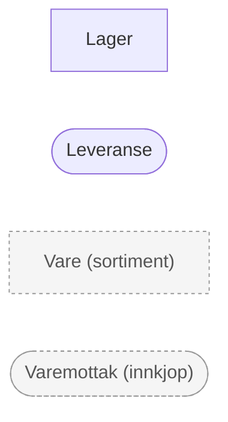
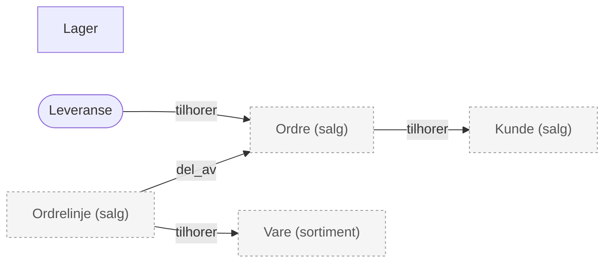
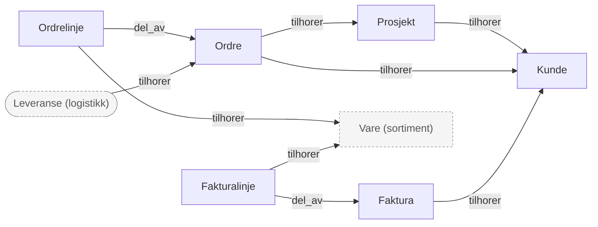
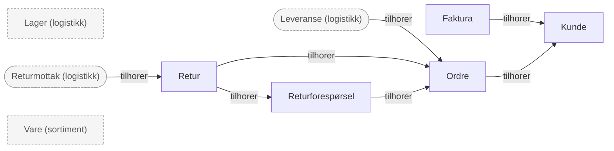

# Oversikt

<!-- GENERERT av scripts/valider.py. Ikke rediger for hånd. -->

Sammenhenger, måltall, systemavvik og uferdige begreper. Se [INDEKS.md](INDEKS.md) for alle begreper.

**Prosessdiagrammene** viser entitetene `[ ]` og hendelsene `([ ])` som inngår i hver forretningsprosess (feltet `begreper` i `prosesser/<id>.md`), og relasjonene mellom dem: `tilhorer`, `del_av` og `er_en`. Pilene leses *fra → til*: `ordre --tilhorer--> kunde`. Grå boks med domenet i parentes = begrep fra et annet domene. Måltall, dimensjoner og klassifiseringer står i tabellene under.

## Domenekart

Antall relasjoner mellom domener (uten forveksles_med, som ikke er en avhengighet).

## Prosesskart

Hvordan prosessene henger sammen i en verdikjede. Heltrukket pil: flyten fortsetter i neste prosess (`Neste: [[prosess]]`). Stiplet pil med begrep: prosessen gir begrepet som starter neste.

## innkjop

**Innkjøp**: Innkjøp av varer fra leverandører, og oppfølging av leverandørene.

### Innkjøp til mottak

[innkjop_til_mottak](prosesser/innkjop_til_mottak.md) (utkast): Fra vi bestiller varer hos en leverandør til varene er mottatt og kontrollert.

## logistikk

**Logistikk**: Lagring og levering av varer: lagre, beholdning, utleveringer og leveringsevne.

Bruker fra andre domener: [kalenderdag](begreper/okonomi/kalenderdag.md) (okonomi), [ordre](begreper/salg/ordre.md) (salg), [ordredato](begreper/salg/ordredato.md) (salg), [ordrelinje](begreper/salg/ordrelinje.md) (salg), [retur](begreper/salg/retur.md) (salg), [vare](begreper/sortiment/vare.md) (sortiment), [varekost](begreper/okonomi/varekost.md) (okonomi)

### Lagerstyring

[lagerstyring](prosesser/lagerstyring.md) (utkast): Å holde riktig beholdning av varer på hvert lager, fra varene mottas til de leveres ut.

### Plukk og levering

[plukk_og_levering](prosesser/plukk_og_levering.md) (utkast): Fra en ordre er klar til utlevering til kunden har kvittert for varene.

## okonomi

**Økonomi**: Regnskap og økonomistyring: omsetning, lønnsomhet, kalenderen og regnskapsperiodene.

Bruker fra andre domener: [fakturadato](begreper/salg/fakturadato.md) (salg), [fakturalinje](begreper/salg/fakturalinje.md) (salg)

_Ingen prosesser ennå._

## salg

**Salg**: Salg til håndverkere og byggeprosjekter: kunder, ordre, priser og fakturering.

Bruker fra andre domener: [vare](begreper/sortiment/vare.md) (sortiment)

### Ordre til faktura

[ordre_til_faktura](prosesser/ordre_til_faktura.md) (utkast): Fra kunden bestiller varer til leveransen er fakturert.

### Retur fra kunde

[retur_fra_kunde](prosesser/retur_fra_kunde.md) (utkast): Fra kunden ber om å returnere varer til varen er kontrollert og kunden er kreditert, eller returen er avvist.

## sortiment

**Sortiment**: Hvilke varer vi fører, og hvordan de grupperes og måles.

_Ingen prosesser ennå._

## Måltall

Grunnlaget for mål i en semantisk modell. **semi_additiv** skal aldri summeres over tid, **ikke_additiv** skal aldri summeres (beregn fra teller og nevner).

| måltall | domene | granularitet | tidsdimensjon | aggregering | additivitet | enhet | avledet_av | status |
|---|---|---|---|---|---|---|---|---|
| [leveringspresisjon_leverandor](begreper/innkjop/leveringspresisjon_leverandor.md) | innkjop | [varemottak](begreper/innkjop/varemottak.md) | [mottaksdato](begreper/innkjop/mottaksdato.md) | ratio | **ikke_additiv** | prosent | [varemottak](begreper/innkjop/varemottak.md), [innkjopsordre](begreper/innkjop/innkjopsordre.md) | godkjent |
| [gjennomsnittlig_lagerbeholdning](begreper/logistikk/gjennomsnittlig_lagerbeholdning.md) | logistikk | [vare](begreper/sortiment/vare.md) | [beholdningsdato](begreper/logistikk/beholdningsdato.md) | snitt | **semi_additiv** | NOK | [lagerbeholdning](begreper/logistikk/lagerbeholdning.md) | utkast |
| [lagerbeholdning](begreper/logistikk/lagerbeholdning.md) | logistikk | [vare](begreper/sortiment/vare.md) | [beholdningsdato](begreper/logistikk/beholdningsdato.md) | sum | **semi_additiv** | NOK | [vare](begreper/sortiment/vare.md), [lager](begreper/logistikk/lager.md) | godkjent |
| [lageromlopshastighet](begreper/logistikk/lageromlopshastighet.md) | logistikk | [vare](begreper/sortiment/vare.md) | [kalenderdag](begreper/okonomi/kalenderdag.md) | ratio | **ikke_additiv** | ganger per år | [varekost](begreper/okonomi/varekost.md), [gjennomsnittlig_lagerbeholdning](begreper/logistikk/gjennomsnittlig_lagerbeholdning.md) | utkast |
| [leveringsgrad](begreper/logistikk/leveringsgrad.md) | logistikk | [ordrelinje](begreper/salg/ordrelinje.md) | [ordredato](begreper/salg/ordredato.md) | ratio | **ikke_additiv** | prosent | [ordrelinje](begreper/salg/ordrelinje.md), [leveranse](begreper/logistikk/leveranse.md), [restordre](begreper/logistikk/restordre.md) | godkjent |
| [dekningsbidrag](begreper/okonomi/dekningsbidrag.md) | okonomi | [fakturalinje](begreper/salg/fakturalinje.md) | [fakturadato](begreper/salg/fakturadato.md) | formel | additiv | NOK | [omsetning](begreper/okonomi/omsetning.md), [varekost](begreper/okonomi/varekost.md) | godkjent |
| [dekningsgrad](begreper/okonomi/dekningsgrad.md) | okonomi | [fakturalinje](begreper/salg/fakturalinje.md) | [fakturadato](begreper/salg/fakturadato.md) | ratio | **ikke_additiv** | prosent | [dekningsbidrag](begreper/okonomi/dekningsbidrag.md), [omsetning](begreper/okonomi/omsetning.md) | godkjent |
| [omsetning](begreper/okonomi/omsetning.md) | okonomi | [fakturalinje](begreper/salg/fakturalinje.md) | [fakturadato](begreper/salg/fakturadato.md) | sum | additiv | NOK | [fakturalinje](begreper/salg/fakturalinje.md) | godkjent |
| [varekost](begreper/okonomi/varekost.md) | okonomi | [fakturalinje](begreper/salg/fakturalinje.md) | [fakturadato](begreper/salg/fakturadato.md) | sum | additiv | NOK | [fakturalinje](begreper/salg/fakturalinje.md) | godkjent |
| [rabatt](begreper/salg/rabatt.md) | salg | [fakturalinje](begreper/salg/fakturalinje.md) | [fakturadato](begreper/salg/fakturadato.md) | sum | additiv | NOK | [fakturalinje](begreper/salg/fakturalinje.md), [listepris](begreper/salg/listepris.md) | utkast |

## Systemdekning

Antall begreper per domene som er beskrevet i hvert system.

| domene | crm | datavarehus | erp | lagerstyringssystem | nettbutikk |
|---|---|---|---|---|---|
| innkjop | 0 | 1 | 4 | 2 | 0 |
| logistikk | 0 | 4 | 5 | 4 | 0 |
| okonomi | 0 | 4 | 2 | 0 | 1 |
| salg | 3 | 1 | 10 | 0 | 1 |
| sortiment | 0 | 0 | 3 | 1 | 2 |

### Autoritativ kilde

Systemet der begrepet oppstår og endres. Les fra kilden. De andre systemene er kopier, og må brukes med avvikene under.

| begrep | type | kilde | kopier |
|---|---|---|---|
| [innkjopsordre](begreper/innkjop/innkjopsordre.md) | entitet | erp |  |
| [leverandor](begreper/innkjop/leverandor.md) | entitet | erp |  |
| [varemottak](begreper/innkjop/varemottak.md) | hendelse | lagerstyringssystem | erp |
| [lager](begreper/logistikk/lager.md) | entitet | **mangler** | lagerstyringssystem, erp |
| [leveranse](begreper/logistikk/leveranse.md) | hendelse | lagerstyringssystem | erp |
| [faktura](begreper/salg/faktura.md) | entitet | erp |  |
| [fakturalinje](begreper/salg/fakturalinje.md) | entitet | erp |  |
| [kunde](begreper/salg/kunde.md) | entitet | erp | crm |
| [ordre](begreper/salg/ordre.md) | entitet | erp | nettbutikk |
| [ordrelinje](begreper/salg/ordrelinje.md) | entitet | erp |  |
| [prosjekt](begreper/salg/prosjekt.md) | entitet | **mangler** | erp, crm |
| [vare](begreper/sortiment/vare.md) | entitet | erp | lagerstyringssystem, nettbutikk |

### Kjente avvik

Der systemet ikke stemmer med forretningsdefinisjonen. Disse filtrene og korreksjonene må med når kildedata brukes.

#### crm

| begrep | avvik |
|---|---|
| [kunde](begreper/salg/kunde.md) | Kontotypen settes manuelt og er ofte utdatert. Bruk ikke CRM til å telle kunder. |
| [kundesegment](begreper/salg/kundesegment.md) | Settes manuelt av selger, og mangler for rundt 10 % av kundene. |
| [prosjekt](begreper/salg/prosjekt.md) | Inneholder også prosjekter som aldri ga ordre. |

#### datavarehus

| begrep | avvik |
|---|---|
| [dekningsbidrag](begreper/okonomi/dekningsbidrag.md) | Arver avviket i [[varekost]] for direkteleveranser. |
| [lageromlopshastighet](begreper/logistikk/lageromlopshastighet.md) | Ikke kartlagt. Se Åpne spørsmål. |
| [leveringsgrad](begreper/logistikk/leveringsgrad.md) | Arver avviket i [[restordre]]: utsatte prosjektleveranser telles som ikke levert i tide. |
| [leveringspresisjon_leverandor](begreper/innkjop/leveringspresisjon_leverandor.md) | Direkteleveranser får for sen mottaksdato (se [[mottaksdato]]), så presisjonen blir noe for lav. |

#### erp

| begrep | avvik |
|---|---|
| [faktura](begreper/salg/faktura.md) | Proformafakturaer ligger i samme register og må filtreres bort. |
| [fakturalinje](begreper/salg/fakturalinje.md) | Frakt, gebyrer og pant ligger også som fakturalinjer og må filtreres bort. |
| [innkjopsordre](begreper/innkjop/innkjopsordre.md) | Bestillingsforslag ligger i samme register med egen status og må filtreres bort. Mangler bekreftet leveringsdato, er ønsket dato brukt. |
| [kunde](begreper/salg/kunde.md) | Kontantsalg føres på én samlekunde, som ikke er en kunde og må filtreres bort. Store byggeprosjekter er ofte opprettet som egne kundenumre. De må slås sammen til kunden via organisasjonsnummeret. |
| [kundesegment](begreper/salg/kundesegment.md) | Prisgruppe brukes ofte som erstatning for segment, men det er et annet begrep. |
| [lager](begreper/logistikk/lager.md) | Har de samme virtuelle lagrene. |
| [lagerbeholdning](begreper/logistikk/lagerbeholdning.md) | ERP har også sin egen beholdning, som kan avvike fra lagerstyringssystemet frem til nattlig avstemming. Bruk antall fra lagerstyringssystemet. |
| [leverandor](begreper/innkjop/leverandor.md) | Registeret inneholder alle kreditorer, også de som leverer tjenester og driftsmidler. Bare kreditorer med kreditortype "vareleverandør" er leverandører. |
| [leveranse](begreper/logistikk/leveranse.md) | Kvitteringen registreres ofte flere dager for sent. |
| [leveringsdato](begreper/logistikk/leveringsdato.md) | Registreringsdato, ofte flere dager for sent. |
| [mottaksdato](begreper/innkjop/mottaksdato.md) | Er datoen kvitteringen ble registrert, ikke datoen varen ble levert. Kan være flere dager for sent. |
| [omsetning](begreper/okonomi/omsetning.md) | Frakt og gebyrer må filtreres bort. |
| [ordre](begreper/salg/ordre.md) | Tilbud må filtreres bort. |
| [ordrelinje](begreper/salg/ordrelinje.md) | Frakt, gebyrer og rene tekstlinjer ligger også som ordrelinjer og må filtreres bort. |
| [prosjekt](begreper/salg/prosjekt.md) | Stort. Fritekstreferansene er ikke konsekvente, og prosjekter med eget kundenummer ser ut som egne kunder. |
| [rabatt](begreper/salg/rabatt.md) | Frakt, gebyrer og pant ligger også som fakturalinjer og må filtreres bort (se [[fakturalinje]]). Ellers ikke kartlagt. |
| [restordre](begreper/logistikk/restordre.md) | Statusen skiller ikke mellom manglende varer og levering utsatt etter kundens ønske. Utsatte leveranser for prosjekter blir derfor feilaktig talt som restordre. |
| [vare](begreper/sortiment/vare.md) | Frakt, gebyrer og pant er registrert som varer med egen varetype. De må filtreres bort. |
| [varekost](begreper/okonomi/varekost.md) | Ved direktelevering kommer leverandørfakturaen ofte etter at vi har fakturert kunden. Da står foreløpig innkjøpspris på linjen, og den rettes ikke i ettertid. |
| [varemottak](begreper/innkjop/varemottak.md) | Kvitteringen registreres ofte flere dager etter faktisk levering. |

#### lagerstyringssystem

| begrep | avvik |
|---|---|
| [lager](begreper/logistikk/lager.md) | Har i tillegg virtuelle lagre for transitt, retur og karantene. De må filtreres bort. |
| [lagerbeholdning](begreper/logistikk/lagerbeholdning.md) | Har ikke verdi. Virtuelle lagre må filtreres bort. |
| [leveranse](begreper/logistikk/leveranse.md) | Registrerer når varene er sendt, ikke når kunden har kvittert. Direkteleveranser mangler. |
| [leveringsdato](begreper/logistikk/leveringsdato.md) | Er datoen varene ble sendt. For kjøring til byggeplass er det vanligvis samme dag, men ikke alltid. |
| [vare](begreper/sortiment/vare.md) | Skaffevarer mangler. |
| [varemottak](begreper/innkjop/varemottak.md) | Direkteleveranser finnes ikke her. |

#### nettbutikk

| begrep | avvik |
|---|---|
| [maaleenhet](begreper/sortiment/maaleenhet.md) | Antall i nettbutikkens rapporter er i salgsenhet, ikke lagerenhet. |
| [omsetning](begreper/okonomi/omsetning.md) | Stort. Ordreverdi, ikke fakturert beløp. Kanselleringer og kreditnotaer er ikke trukket fra. Bruk ikke nettbutikkens tall som omsetning. |
| [ordre](begreper/salg/ordre.md) | Handlekurver som avvises ved overføring til ERP, f.eks. på grunn av kredittsperre, finnes bare her og er ikke ordre. |
| [vare](begreper/sortiment/vare.md) | Varer som ikke selges på nett, er skjult og mangler i katalogen. |

## Uferdig

Begreper og prosesser som ikke er godkjent, eller som har åpne spørsmål.

| begrep | type | status | åpne spørsmål |
|---|---|---|---|
| [gjennomsnittlig_lagerbeholdning](begreper/logistikk/gjennomsnittlig_lagerbeholdning.md) | maaltall | utkast | 1 |
| [innkjop_til_mottak](prosesser/innkjop_til_mottak.md) | prosess | utkast | 5 |
| [lageromlopshastighet](begreper/logistikk/lageromlopshastighet.md) | maaltall | utkast | 2 |
| [lagerstyring](prosesser/lagerstyring.md) | prosess | utkast | 5 |
| [listepris](begreper/salg/listepris.md) | dimensjon | utkast | 2 |
| [ordre_til_faktura](prosesser/ordre_til_faktura.md) | prosess | utkast | 4 |
| [plukk_og_levering](prosesser/plukk_og_levering.md) | prosess | utkast | 5 |
| [prosjekt](begreper/salg/prosjekt.md) | entitet | til_godkjenning | 2 |
| [rabatt](begreper/salg/rabatt.md) | maaltall | utkast | 3 |
| [reklamasjon](begreper/salg/reklamasjon.md) | entitet | utkast | 4 |
| [restordre](begreper/logistikk/restordre.md) | klassifisering | godkjent | 1 |
| [retur](begreper/salg/retur.md) | entitet | utkast | 2 |
| [retur_fra_kunde](prosesser/retur_fra_kunde.md) | prosess | utkast | 5 |
| [returforesporsel](begreper/salg/returforesporsel.md) | entitet | utkast | 2 |
| [returmottak](begreper/logistikk/returmottak.md) | hendelse | utkast | 2 |
| [returmottaksdato](begreper/logistikk/returmottaksdato.md) | dimensjon | utkast | 1 |
